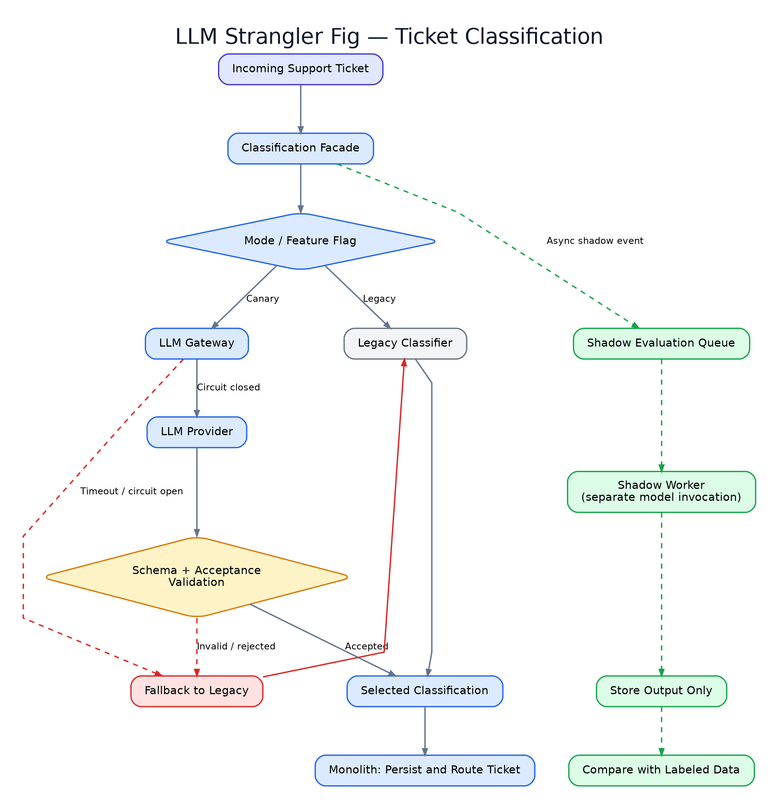

# LLM Strangler Fig — companion sketch

Illustrative Node.js + Express demo. No provider credentials or actual LLM requests.

## Run

Requires Node.js >= 20.

```bash
npm install
npm test
npm start
curl -X POST http://127.0.0.1:3000/classify -H 'Content-Type: application/json' -d '{"tenantId":"demo","description":"API login error"}'
```

## Layout

- `src/legacy.js` — simple deterministic fallback classifier.
- `src/schema.js` — Ajv JSON Schema validator.
- `src/flags.js` — deterministic tenant-based percentage rollout.
- `src/breaker.js` — small educational circuit-breaker state machine.
- `src/gateway.js` — model adapter, timeout signal, validation, fallback.
- `src/server.js` — Express HTTP route, legacy-only by default.
- `test/gateway.test.js` — fallback and happy-path tests.

## Important limits

- The `model` adapter is injected; no actual model is configured.
- The gateway deadline bounds waiting; underlying work only stops if the adapter honors `AbortSignal`.
- This example does not implement durable shadow processing, calibrated quality checks,
  semantic acceptance policy, authentication, tenant authorization, tracing, or PII controls.
- Circuit breaker state is per-process, not shared across replicas.
- Do not use production data or enable model routing without hardening and testing.

## Architecture diagram



- [Download / inspect the diagram PNG](docs/mermaid-diagram.png)
- [Edit the Mermaid source](docs/architecture.mmd)

The PNG illustrates the same flows as the Mermaid source and is provided for platforms where Mermaid does not render. The shadow path shown is **architectural**, not implemented in the demo code.

## Further Reading

If you enjoyed this, my book From Legacy to Intelligent goes deeper i.

[You can find the book here](https://ovidiubooks.07.ro/l/iqcpm).

No legacy monoliths were harmed in the writing.